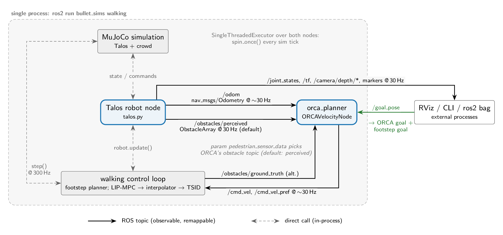

## Install Instructions
The Docker Container provided by the lecture was used, so dependencies should match.

```bash
docker pull ghcr.io/frustiger/tum-ics-ros:jazzy-legged-robotics-devel-vscode
```

The workspace should be recreated like this:

```bash
mkdir -p /workspaces/legged_robots/legged_robots_ws/src
# copy the delivered src folder into /workspaces/legged_robots/legged_robots_ws/src
cd /workspaces/legged_robots/legged_robots_ws
source /opt/ros/rolling/setup.bash
colcon build
source install/setup.bash
```

Important: run every script and launch file from the workspace root, not from inside a package directory. The code loads URDFs and other assets using paths such as `src/talos_description/...`, so the workspace layout must stay intact.

## Main Run Commands

Using a different workspace structure needs adjustment of the rviz2 commands with the correct cwd!

## Crowd Navigation (Final Project)

An ORCA-driven pedestrian crowd simulated in MuJoCo. Each pedestrian is a
kinematic disk (a mocap cylinder) that steers toward its goal while reciprocally
avoiding the others via ORCA. Code lives in `src/orca_nav/orca_nav/`
(`orca.py`, `pedestrian.py`, `scenarios.py`) with a standalone viewer demo in
`crowd_demo.py`.

### Run the crowd demo

```bash
cd /workspaces/crowd_navigation/talos_crowd_navigation
colcon build --packages-select orca_nav
source install/setup.bash

ros2 run orca_nav crowd_demo <scenario> [max_seconds]
```

Scenarios: `head_on`, `crossing` (default), `circle`, `corridor`, `random`.
Example: `ros2 run orca_nav crowd_demo random 60`.

### Adjustable parameters

**Crowd-wide defaults — `PedestrianSimulator(...)` in `crowd_demo.py`:**

| Parameter | Default | Meaning |
|---|---|---|
| `radius` | `0.3` | Disk radius [m] — physical size *and* ORCA collision size. |
| `max_speed` | `1.3` | Top walking speed [m/s]. |
| `height` | `1.7` | Cylinder height [m], visual only (no effect on avoidance). |
| `personal_space` | `0.1` | Extra clearance [m] kept beyond the radii. Larger = more spread-out crowd. |
| `goal_tol` | `0.3` | Distance [m] at which a pedestrian counts as "arrived". |
| `pref_perturb` | `0.0` | Random noise [m/s] on preferred velocity; ~`0.05` breaks symmetric deadlocks. |
| `responsibility` | `0.5` | Share of avoidance each agent takes (`0.5` = reciprocal; `1.0` = yield fully). |
| `contact` | `False` | `True` = disks physically collide with the robot instead of being "ghosts". |
| `seed` | `0` | RNG seed for the perturbation (reproducibility). |

**ORCA solver tuning — `ORCAParams(...)`, passed as `params=`:**

| Parameter | Default | Meaning |
|---|---|---|
| `neighbor_dist` | `4.0` | How far [m] an agent looks for others to avoid. |
| `max_neighbors` | `10` | Cap on neighbors considered per agent. |
| `time_horizon` | `2.5` | Look-ahead [s] for collisions. Higher = more anticipatory, wider berths. |
| `time_step` | `0.05` | Internal planning tick [s]. |

**Per-pedestrian overrides — `crowd.add(...)`:** `radius`, `max_speed`, `height`,
`color`, and `on_arrival` (`"reverse"` = loop back and forth, `"stop"` = halt,
`"remove"` = deactivate).

**Scenario shape — `scenarios.*` functions:** e.g. `crossing(crowd, gap=6.0)`,
`circle(crowd, n=8, radius=4.0, jitter=0.15)`,
`corridor(crowd, n_each=3, length=8.0, width=1.6, speed=1.2)`,
`random_crowd(crowd, n=12, extent=5.0)`.

**Simulation rate — `MujocoWrapper(...)` in `crowd_demo.py`:** `sim_rate` [Hz] and
`num_sub_steps` (physics substeps per control step).

The two parameters that most change the feel of the crowd are `radius` /
`personal_space` (how much space pedestrians demand) and `time_horizon` (how far
ahead they plan — high looks polite and anticipatory, low looks last-second).

### Running the walking demo (runtime parameters)

The full navigation demo — Talos walking to a goal while avoiding the crowd — is:

```bash
colcon build --packages-select bullet_sims orca_nav
source install/setup.bash
ros2 run bullet_sims walking
```

Two settings can be changed at launch as ROS 2 parameters, without editing code
or rebuilding (defaults are the constants at the top of `walking.py`):

| Parameter | Type | Default | Meaning |
|---|---|---|---|
| `scenario` | string | `random` | Crowd scenario: `head_on`, `crossing`, `circle`, `corridor`, `random`. |
| `pedestrian_sensor_data` | bool | `true` | `false` = the robot uses ground-truth pedestrian states; `true` = it uses only what its onboard depth camera perceives (`obstacles2d()`). |

Override them with `--ros-args -p name:=value`:

```bash
# crossing crowd, ground-truth pedestrian states
ros2 run bullet_sims walking --ros-args -p scenario:=crossing -p pedestrian_sensor_data:=false

# head-on crowd, depth-camera perception (only what the robot sees)
ros2 run bullet_sims walking --ros-args -p scenario:=head_on -p pedestrian_sensor_data:=true
```

The chosen values are printed at startup. Note: `pedestrian_sensor_data:=true`
requires the depth+segmentation perception path (the camera-based `update_obstacles()`);
with `false` the camera is not used at all.

### ROS communication architecture (topics)

The navigation components communicate over ROS 2 topics rather than direct
function calls, even though everything currently runs in a single process
(`walking.py` spins a `SingleThreadedExecutor` over two nodes once per sim
tick). Only the 300 Hz whole-body control chain (MPC → interpolator → TSID)
stays as direct calls — topics inside that loop would add latency for no
benefit. Because the boundaries are topics, every intermediate signal can be
watched, recorded (`ros2 bag`) or replaced from outside, and any component
could later be moved into its own process with a remap instead of a code
change.



*Solid arrows are ROS topics (observable, remappable); dashed arrows are
direct in-process calls. Blue boxes are this project's nodes.*

**The nodes and the data flow:**

```
                         talos robot node                    orca_planner
                         ────────────────                    ────────────
sim ground truth ──────► /obstacles/ground_truth ──┐
depth-camera tracker ──► /obstacles/perceived ─────┤ (one of the two,
                                                   │  see listening modes)
robot base state ──────► /odom ────────────────────┴──► ORCA solver
                                                            │
    footstep planner ◄── /cmd_vel ◄─────────────────────────┤
    (in walking.py)      /cmd_vel_pref ◄────────────────────┘
           ▲
RViz / CLI ┴───────────► /goal_pose ──► (both: ORCA goal + footstep goal)
```

The ORCA node (`src/orca_nav/orca_nav/orca_node.py`) recomputes and publishes
`cmd_vel` on every incoming `odom` message (~30 Hz — plenty, since the
reactive footstep planner only samples the command once per ~0.8 s step, as
an average over the step). It also runs standalone:
`ros2 run orca_nav orca_planner` with `-p goal_x/goal_y/obstacle_topic/...`.

**Listening modes (which obstacle data drives the robot):** the
`pedestrian_sensor_data` parameter picks which topic the ORCA node subscribes
to — it is a topic selection, not a different code path:

| Mode | Launch | ORCA subscribes to | Meaning |
|---|---|---|---|
| Perception (default) | `-p pedestrian_sensor_data:=true` | `/obstacles/perceived` | The robot reacts only to pedestrians its onboard depth camera currently sees (occluded ones are held briefly, then dropped). |
| Ground truth | `-p pedestrian_sensor_data:=false` | `/obstacles/ground_truth` | The robot reacts to the simulator's exact pedestrian states — an upper bound / debugging reference. |

`/obstacles/ground_truth` is published in both modes (for comparison and
logging); `/obstacles/perceived` only carries data when perception is on.

**All topics:**

| Topic | Type | Content |
|---|---|---|
| `/cmd_vel` | geometry_msgs/TwistStamped | ORCA avoidance velocity — drives the footsteps. |
| `/cmd_vel_pref` | geometry_msgs/TwistStamped | ORCA preferred (goal-seeking) velocity; difference to `/cmd_vel` = the crowd's influence. |
| `/obstacles/ground_truth` | crowd_nav_interfaces/ObstacleArray | True pedestrian states (x, y, radius, vx, vy) from the crowd sim. |
| `/obstacles/perceived` | crowd_nav_interfaces/ObstacleArray | Depth-camera tracker estimates, incl. a `stale` flag for briefly-occluded tracks. |
| `/odom` | nav_msgs/Odometry | base_link pose; **twist is world-frame** (project convention, ORCA consumes it directly). |
| `/goal_pose` | geometry_msgs/PoseStamped | Input: retargets ORCA *and* the footstep planner mid-run (works with RViz "2D Goal Pose"). |
| `/joint_states`, `/tf` | — | Robot state for RViz. |
| `/wrench_rf`, `/wrench_lf` | geometry_msgs/WrenchStamped | Foot force/torque readings. |
| `/camera/depth/image_rect`, `/camera/depth/camera_info` | sensor_msgs | Head-camera depth stream (feeds `depth_image_proc`). |
| `/zmp`, `/obstacle_markers` | visualization_msgs/MarkerArray | Visualization only (markers mirror `/obstacles/perceived`). |

**Watching from a second terminal:**

```bash
cd <workspace root>
source install/setup.bash     # REQUIRED for the ObstacleArray topics: the
                              # custom message type lives in this workspace
ros2 topic list
ros2 topic echo /cmd_vel
ros2 topic echo /obstacles/perceived
ros2 topic hz /cmd_vel
ros2 node info /orca_planner  # full sub/pub wiring of the ORCA node
```

Gotchas:

- Without `source install/setup.bash`, echoing an obstacle topic fails with
  *"The message type 'crowd_nav_interfaces/msg/ObstacleArray' is invalid"*.
  If it still fails after sourcing, run `ros2 daemon stop` once (stale type
  cache).
- Topics are silent while the MuJoCo model compiles at startup, and with the
  viewer on the sim runs ~10x slower than realtime — expect "30 Hz" topics
  to tick at ~3 Hz of wall time.

**Retargeting the goal mid-run:**

```bash
ros2 topic pub --once /goal_pose geometry_msgs/msg/PoseStamped \
  "{pose: {position: {x: -2.0, y: 1.0}}}"
```

Both the ORCA node and the reactive footstep planner pick the new goal up
immediately (the run prints `[nav] new goal from goal_pose: ...`).

## Group members final project:
Lara Heidtmann , Florian Bohnes, Sebastián Serna, Moritz Heber, Nicolas Guenther

## Notes

- If the interactive marker starts in `base_link` once in a while, rerun the launch file. The marker node waits for TF, but startup timing can still vary slightly on slower machines.
- If the robot model does not appear in RViz, the workspace was likely not built from the root or the `robot_description` did not get loaded.